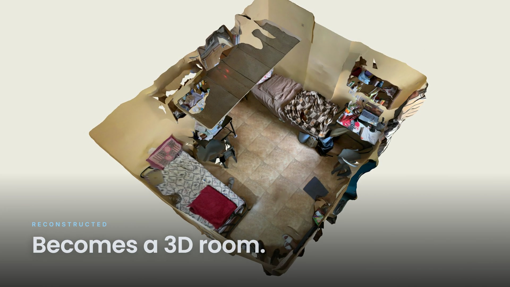
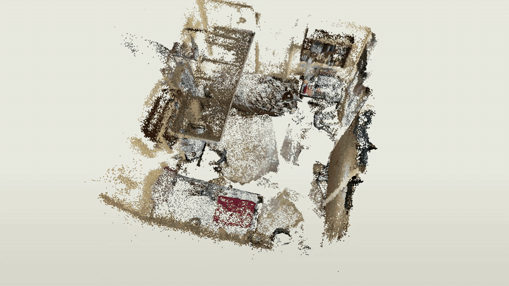
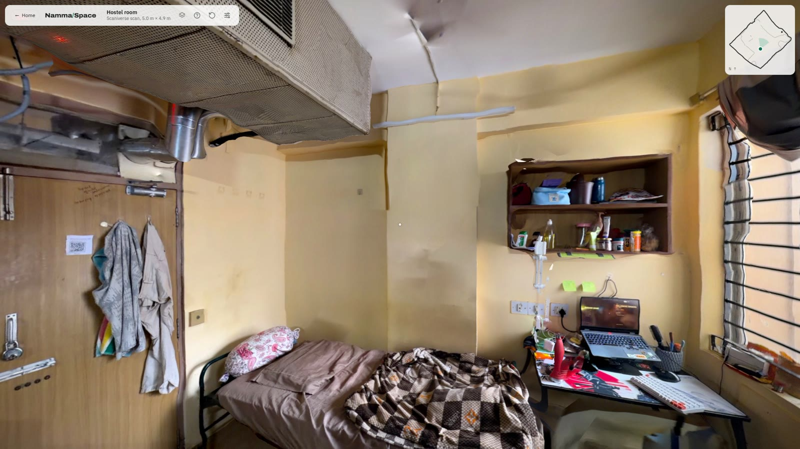
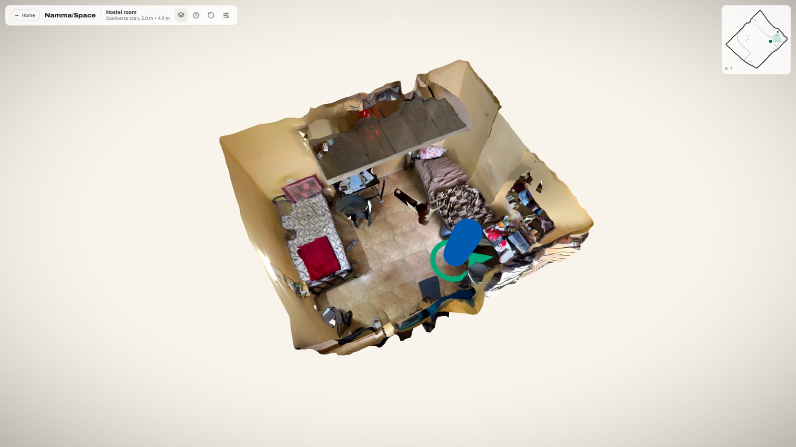
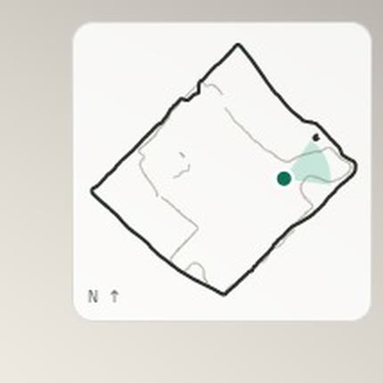
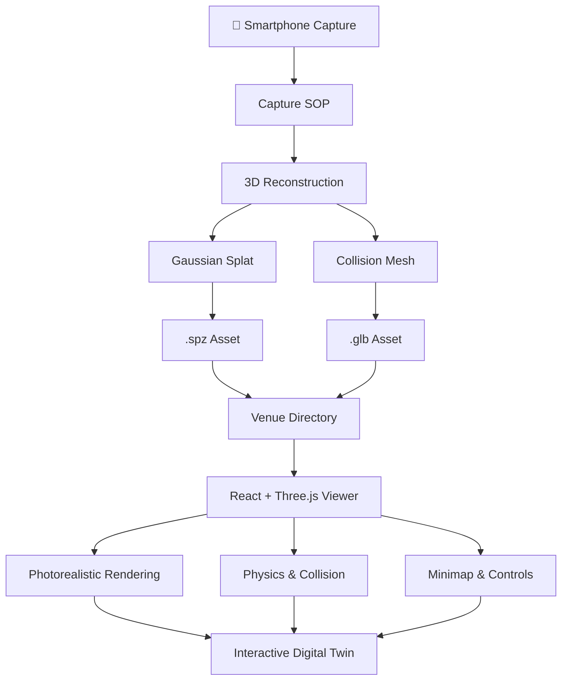
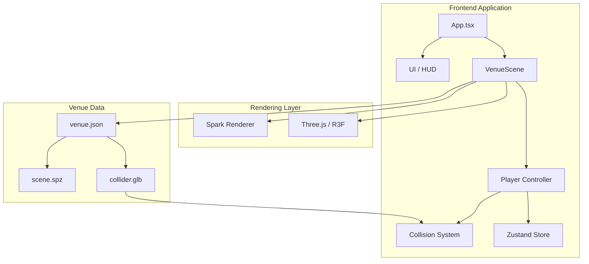

# ◈ DOORWAY

<p align="center">
  
</p>

<p align="center">
  <strong>Live:</strong> <a href="https://namma-space-three.vercel.app">namma-space-three.vercel.app</a>
  &nbsp;·&nbsp;
  <strong>Walk the scan directly:</strong> <a href="https://namma-space-three.vercel.app/experience/">/experience/</a>
</p>

<p align="center">
  <strong>Digital Spaces. Reimagined.</strong>
  <br />
  Turn ordinary phone captures into photorealistic, explorable 3D digital twins.
  <br />
  <em>Capture a space. Reconstruct its world. Step inside.</em>
</p>

<p align="center">
  <a href="#-overview"></a>
  
  
  
</p>

<p align="center">
  <a href="#-features">Features</a> •
  <a href="#-how-it-works">How It Works</a> •
  <a href="#-getting-started">Get Started</a> •
  <a href="#-architecture">Architecture</a> •
  <a href="#-roadmap">Roadmap</a> •
  <a href="#-team">Team</a>
</p>

---

<p align="center">
  
</p>

<p align="center">
  <sub>One phone scan of a hostel room: the raw point cloud becomes the textured room you can walk through.</sub>
</p>

---

## ◈ Overview

What if you could walk through a building before ever setting foot inside it?

**Doorway** is an attempt to bridge the physical and digital worlds by transforming ordinary smartphone captures of indoor environments into photorealistic, interactive 3D digital twins.

Instead of relying on expensive scanning hardware or specialized equipment, Doorway aims to make spatial digitization accessible through everyday phones.

The reconstructed environments can be explored directly in a browser, navigated using intuitive movement controls, and eventually used for on-site augmented reality guidance.

Built for the **Namma Space** challenge at **Techfest 2026–27, IIT Bombay**.

### The idea

| Physical World | Digital World |
|:---:|:---:|
| 📱 Smartphone captures | 🧩 3D reconstruction |
| 🏢 Real indoor environments | 🌐 Interactive digital twins |
| 🚶 Physical navigation | 🎮 Browser-based exploration |
| 📍 Physical destinations | 🧭 Search and AR guidance |

## ✦ Features

### 01 — Photorealistic Reconstruction

Turn a smartphone scan (Scaniverse) into a walkable 3D twin, with no manual modelling.

- Textured scan meshes shown with their captured lighting (the live hostel room and classroom).
- Gaussian splats rendered with [Spark](https://sparkjs.dev) when a good splat is available (`?venue=katpadi`).
- Coloured point clouds turned into venues automatically, collision included (`pipeline/points-to-venue.mjs`).
- `pipeline/clean-mesh.mjs` removes floating debris and shrinks scans for the web (4K texture for phones, 8K for desktops).
- Real-world environments instead of manually modelled scenes.

### 02 — First-Person Exploration

Step inside reconstructed environments.

- WASD-based first-person movement.
- Mouse-controlled camera.
- Capsule-based player collision.
- Wall and floor collision handling.
- Smooth movement along collision surfaces.
- Mobile joystick and touch-based camera controls.

### 03 — Spatial Awareness

Understand the environment while exploring it.

- Opening fly-through: the whole space from above, then down to eye level.
- Overview mode (**V**): orbit the whole space, with the visitor's position marked.
- Real-time minimap, sliced from the scan geometry.
- Configurable movement and viewing settings.

### 04 — Venue-Based Architecture

Every reconstructed space is treated as independent data.

- Individual venue directories.
- `venue.json` configuration.
- Reusable scene-loading architecture.
- Add new environments without modifying application logic.

### 05 — What's Coming Next

- Point-of-interest identification and labels.
- Searchable indoor destinations.
- Obstacle-aware navigation.
- On-site augmented reality guidance.

---

## ◈ See It In Action

<p align="center">
  
  <br />
  <sub>01 / First person inside the scanned hostel room</sub>
</p>

<p align="center">
  
  &nbsp;
  
  <br />
  <sub>02 / Overview mode (V) &nbsp;&nbsp; 03 / Minimap sliced from the scan</sub>
</p>

All screenshots are frames from the running viewer.

---

## ⚙ How It Works

Doorway uses two complementary representations of the same physical environment.

**One representation for visual fidelity. Another for physical interaction.**



### Two representations. One environment.

| Layer | Technology | Responsibility |
|---|---|---|
| Visual layer | Textured scan mesh (default), Gaussian splat or point cloud | Photorealistic rendering |
| Geometry layer | GLB Mesh | Collision, floor plan and navigation |
| Acceleration | BVH | Efficient spatial queries |
| Application | Three.js / R3F | Interactive 3D environment |
| State | Zustand | Application state management |
| Venue system | JSON | Environment configuration |

### Why a separate visual layer and collision mesh?

**Visual layer — For Looks**

The visitor sees the scan as captured. For the live hostel room and classroom this is the textured mesh shown with its baked-in lighting, which looked sharpest at eye level for our captures. Gaussian splats (rendered with Spark) and coloured point clouds plug into the same slot when a capture provides them.

**Collision Mesh — For Walking**

A decimated mesh extracted from the same scan provides the physical geometry needed for navigation.

Using `three-mesh-bvh`, the application performs accelerated spatial queries and pushes the player capsule out of intersecting geometry.

This allows the player to:
- Stay grounded on the floor.
- Avoid walking through walls.
- Slide along collision surfaces.

The same geometry also provides the basis for floor-plan slicing and future navigation systems.

---

## 🧠 Architecture



### Project Structure

```text
doorway/
│
├── src/
│   ├── App.tsx
│   │
│   ├── scene/
│   │   ├── VenueScene.tsx       loads the visual layer + collision mesh
│   │   ├── Player.tsx           first-person capsule walker
│   │   ├── CameraDirector.tsx   opening fly-through and overview mode
│   │   ├── collider.ts          BVH collider and minimap slicing
│   │   └── demoLayout.ts        procedural development layout
│   ├── align/                   alignment tool (align.html)
│   ├── ui/                      top bar, settings, controls, minimap, joystick
│   └── venue/                   venue.json types and loading
│
├── public/venues/<venue-id>/    venue.json + cleaned scan files
│   ├── hostel/                  default venue (live)
│   ├── classroom/
│   └── katpadi/                 splat example
│
├── pipeline/                    clean-mesh, points-to-venue, compress-splat, check-venue
├── test/                        real sample capture + rebuild steps, and a synthetic test room
├── landing/                     landing site; the viewer is served at /experience/
├── docs/                        SOP.md, task lists, README images
├── vercel.json                  deployment
├── package.json
└── README.md
```

---

## 🚀 Getting Started

### Prerequisites

Make sure you have the following installed:

| Requirement | Version |
|---|---|
| Node.js | 20 or newer |
| npm | Included with Node.js |
| Git | Latest stable version |
| Browser | Modern WebGL-compatible browser |

### Installation

**1. Clone the repository**

```bash
git clone https://github.com/yashrajkanawade357/Namma-Space-Game-AR-VR.git
```

**2. Navigate to the project**

```bash
cd Namma-Space-Game-AR-VR
```

**3. Install dependencies**

```bash
npm install
```

**4. Start the development server**

```bash
npm run dev
```

**5. Open the viewer**

```text
http://localhost:5173/experience/
```

The viewer lives under `/experience/` because the landing site serves it there. To run the whole site
(landing page + viewer, production build) instead:

```bash
cd landing && npm install && npm start
```

and open `http://localhost:4173/`.

### Available Environments

| URL (after `/experience/`) | Description |
|---|---|
| *(none)* | **Hostel room**: Scaniverse scan, the default venue |
| `?venue=classroom` | Classroom: a second Scaniverse scan, 9.6 m × 9.2 m |
| `?venue=katpadi` | The same capture shown as a Gaussian splat |
| `?venue=demo` | Procedural demo layout for development (labelled as a demo) |
| `?venue=sample` | Synthetic test room from `test/venues/sample` |
| `?venue=<id>` | Any folder in `public/venues/<id>/` |

---

## 🎮 Controls

| Action | Desktop | Mobile |
|---|---|---|
| Move forward | `W` | Joystick |
| Move backward | `S` | Joystick |
| Move left | `A` | Joystick |
| Move right | `D` | Joystick |
| Look around | Mouse | Touch drag |
| Move faster | `Shift` | — |
| Return to start | `R` | — |
| Overview of the whole space | `V` | Layers button |
| Skip the opening fly-through | Any key or click | Tap |
| Show controls | `H` | On-screen UI |
| Release mouse | `Esc` | — |

**Desktop tip:** Click inside the 3D viewer to activate mouse look.

---

## 🏗 Add Your Own Venue

Doorway is designed around a reusable venue system.

A new environment should be deployable by adding its assets and configuration rather than rewriting application code.

### Step 1 — Capture

Follow the smartphone capture procedure:

📖 [`docs/SOP.md`](docs/SOP.md)

### Step 2 — Reconstruct

Process your capture using the pipeline documentation:

📖 [`pipeline/README.md`](pipeline/README.md)

### Step 3 — Generate Assets

Clean the Scaniverse mesh export (welds, removes floating debris, resizes the texture):

```bash
node pipeline/clean-mesh.mjs captures/home/scan.glb public/venues/home/home.glb --triangles 200000 --texture 4096
```

Then write `public/venues/home/venue.json` and line the model up with the alignment tool at
`http://localhost:5173/experience/align.html?venue=home` (level, scale, copy the transform).
Only have a point cloud? `node pipeline/points-to-venue.mjs scan.ply public/venues/home --z-up` builds the whole
venue, collision included. A full worked example with a real capture is in [`test/README.md`](test/README.md).

### Step 4 — Validate

```bash
npm run check:venue -- public/venues/home
```

### Step 5 — Explore

```text
http://localhost:5173/experience/?venue=home
```

---

## 🗺 Roadmap

The project is being developed in three stages.

### Round 01 — Digital Reconstruction

- [x] React + Three.js application foundation
- [x] Venue-based asset architecture (`venue.json` per space)
- [x] Gaussian splat, textured mesh and point-cloud visual layers
- [x] First-person movement (WASD + mouse, touch joystick)
- [x] BVH-based collision against the scan mesh
- [x] Minimap sliced from the scan, opening fly-through, overview mode (V)
- [x] Capture SOP ([`docs/SOP.md`](docs/SOP.md))
- [x] Capture-to-venue pipeline: `clean-mesh.mjs`, `points-to-venue.mjs`, alignment tool, `check:venue`
- [x] Real captured venues: hostel room (default) and classroom
- [x] Live deployment with landing page: [namma-space-three.vercel.app](https://namma-space-three.vercel.app)

### Round 02 — Intelligent Navigation

- [ ] Point-of-interest identification
- [ ] Interactive spatial labels
- [ ] Searchable indoor destinations
- [ ] Obstacle-aware desktop navigation
- [ ] Navigation mesh integration
- [ ] Improved spatial interaction

### Round 03 — Augmented Reality

- [ ] On-site capture at IIT Bombay
- [ ] Physical-to-digital environment alignment
- [ ] AR navigation guidance
- [ ] Real-world destination guidance
- [ ] Final integrated demonstration

<sub>Roadmap items reflect development targets, not completed functionality. Individual checkboxes should be updated as implementation is verified.</sub>

---

## 🧰 Tech Stack

<p align="center">
  
</p>

| Category | Technologies |
|---|---|
| Frontend | React, TypeScript, Vite |
| 3D Rendering | Three.js, React Three Fiber |
| Splat Rendering | Spark |
| Collision Detection | three-mesh-bvh |
| State Management | Zustand |
| Styling | Tailwind CSS |
| Spatial Assets | Textured GLB meshes, Gaussian splats (.spz / .ply), point clouds (.ply) |
| Capture | Scaniverse (used for both live venues); Polycam as an alternative |
| Reconstruction & Processing | Scaniverse exports, gltf-transform + meshoptimizer (`clean-mesh.mjs`), our alignment tool |

---

## 👥 Team

Built with curiosity, experimentation, and a shared ambition to make physical spaces digitally accessible.

| Contributor | Responsibility |
|---|---|
| **Yashraj Kanawade** | Project coordination, 3D scanning and reconstruction |
| **Ashmit** | Web application and software engineering |
| **Harshit** | Scanning workflows and 3D model development |

<p align="center">
  <strong>Built for the Namma Space challenge · Techfest 2026–27 · IIT Bombay</strong>
  <br />
  <sub>From a smartphone capture to a world you can walk through.</sub>
</p>

---

<p align="center">
  
  
</p>

<p align="center">
  <em>Every space has a story. We're building a way to step inside it.</em>
</p>

## 🌍 Landing Website

The repository also includes the Doorway landing site in [`landing/`](landing/). It contains the Earth-backed Three.js intro and transitions into the viewer above.

```bash
cd landing
npm install
npm start
```

Open `http://localhost:4173/`. The start command builds the viewer into `landing/experience/` before serving the combined site.
