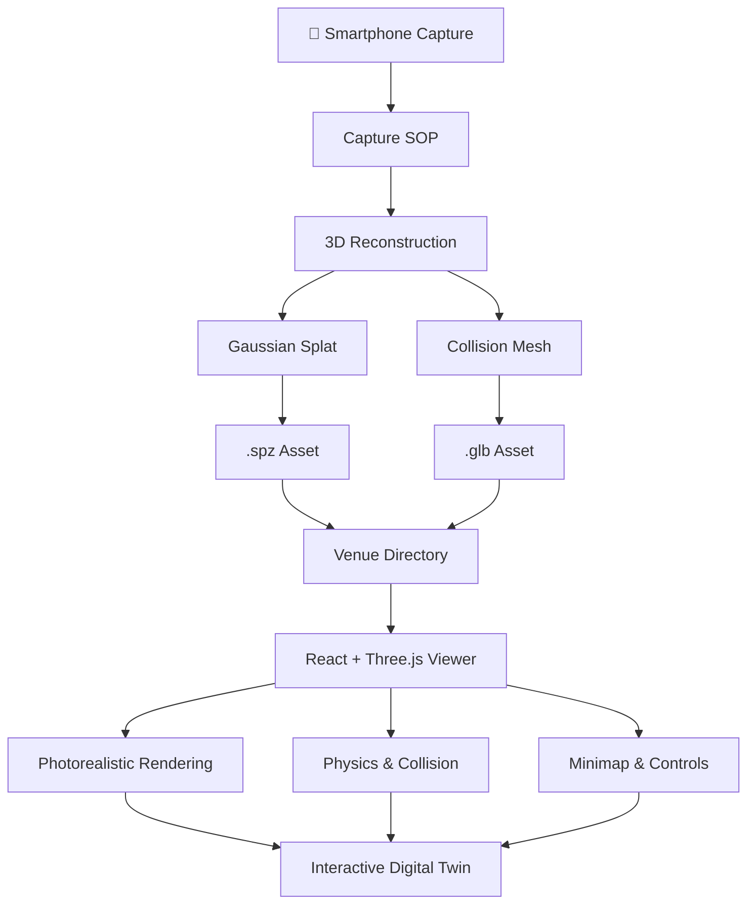
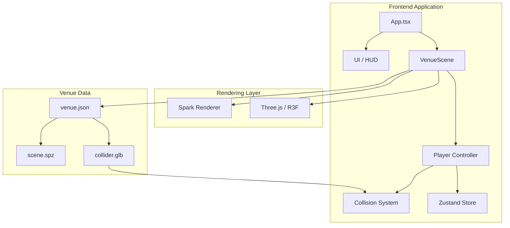

# ◈ NAMMA SPACE

<p align="center">
  
</p>

<p align="center">
  <strong>Digital Spaces. Reimagined.</strong>
  <br />
  Turn ordinary phone captures into photorealistic, explorable 3D digital twins.
  <br />
  <em>Capture a space. Reconstruct its world. Step inside.</em>
</p>

<p align="center">
  <a href="#-overview"></a>
  
  
  
</p>

<p align="center">
  <a href="#-features">Features</a> •
  <a href="#-how-it-works">How It Works</a> •
  <a href="#-getting-started">Get Started</a> •
  <a href="#-architecture">Architecture</a> •
  <a href="#-roadmap">Roadmap</a> •
  <a href="#-team">Team</a>
</p>

---

<!-- Replace with an actual screen recording converted to GIF -->
<p align="center">
  
</p>

<p align="center">
  <sub>Explore real spaces through an interactive digital twin — right from your browser.</sub>
</p>

---

## ◈ Overview

What if you could walk through a building before ever setting foot inside it?

**Namma Space** is an attempt to bridge the physical and digital worlds by transforming ordinary smartphone captures of indoor environments into photorealistic, interactive 3D digital twins.

Instead of relying on expensive scanning hardware or specialized equipment, Namma Space aims to make spatial digitization accessible through everyday phones.

The reconstructed environments can be explored directly in a browser, navigated using intuitive movement controls, and eventually used for on-site augmented reality guidance.

Built for **Namma Space — Techfest 2026–27, IIT Bombay**.

### The idea

| Physical World | Digital World |
|:---:|:---:|
| 📱 Smartphone captures | 🧩 3D reconstruction |
| 🏢 Real indoor environments | 🌐 Interactive digital twins |
| 🚶 Physical navigation | 🎮 Browser-based exploration |
| 📍 Physical destinations | 🧭 Search and AR guidance |

## ✦ Features

### 01 — Photorealistic Reconstruction

Transform smartphone captures into Gaussian Splat representations of indoor environments.

- Photorealistic spatial representation.
- Gaussian Splat rendering using [Spark](https://sparkjs.dev).
- Compressed `.spz` assets for deployment.
- Real-world environments instead of manually modelled scenes.

### 02 — First-Person Exploration

Step inside reconstructed environments.

- WASD-based first-person movement.
- Mouse-controlled camera.
- Capsule-based player collision.
- Wall and floor collision handling.
- Smooth movement along collision surfaces.
- Mobile joystick and touch-based camera controls.

### 03 — Spatial Awareness

Understand the environment while exploring it.

- Real-time minimap.
- Floor-plan representation generated from scan geometry.
- Player position tracking.
- Configurable movement and viewing settings.

### 04 — Venue-Based Architecture

Every reconstructed space is treated as independent data.

- Individual venue directories.
- `venue.json` configuration.
- Reusable scene-loading architecture.
- Add new environments without modifying application logic.

### 05 — What's Coming Next

- Point-of-interest identification and labels.
- Searchable indoor destinations.
- Obstacle-aware navigation.
- On-site augmented reality guidance.

---

## ◈ See It In Action

<p align="center">
  
  <br />
  <sub>01 / Interactive 3D Environment</sub>
</p>

<p align="center">
  
  &nbsp;
  
  <br />
  <sub>02 / Spatial Minimap &nbsp;&nbsp; 03 / Movement Interface</sub>
</p>

> **Media note:** Replace these image paths with actual screenshots from the running application. A 10–20 second walkthrough GIF or short WebM recording is the best hero asset.

---

## ⚙ How It Works

Namma Space uses two complementary representations of the same physical environment.

**One representation for visual fidelity. Another for physical interaction.**



### Two representations. One environment.

| Layer | Technology | Responsibility |
|---|---|---|
| Visual layer | Gaussian Splats | Photorealistic rendering |
| Geometry layer | GLB Mesh | Collision and navigation |
| Acceleration | BVH | Efficient spatial queries |
| Application | Three.js / R3F | Interactive 3D environment |
| State | Zustand | Application state management |
| Venue system | JSON | Environment configuration |

### Why Gaussian Splats + Mesh?

**Gaussian Splats — For Looks**

Gaussian Splatting preserves the appearance of captured environments with impressive visual fidelity. Namma Space uses Spark to render these representations in the browser.

**Collision Mesh — For Walking**

A decimated mesh extracted from the same scan provides the physical geometry needed for navigation.

Using `three-mesh-bvh`, the application performs accelerated spatial queries and pushes the player capsule out of intersecting geometry.

This allows the player to:
- Stay grounded on the floor.
- Avoid walking through walls.
- Slide along collision surfaces.

The same geometry also provides the basis for floor-plan slicing and future navigation systems.

---

## 🧠 Architecture



### Project Structure

```text
namma-space/
│
├── src/
│   ├── App.tsx
│   │
│   ├── scene/
│   │   ├── VenueScene.tsx
│   │   ├── Player.tsx
│   │   ├── collider.ts
│   │   └── demoLayout.ts
│   │
│   ├── ui/
│   │   ├── TopBar
│   │   ├── Settings
│   │   ├── ControlsOverlay
│   │   ├── Minimap
│   │   └── Joystick
│   │
│   └── venue/
│       └── venue.json types and loading
│
├── public/
│   └── venues/
│       └── <venue-id>/
│           ├── venue.json
│           ├── scene.spz
│           └── collider.glb
│
├── pipeline/
│   ├── README.md
│   └── capture-to-venue scripts
│
├── test/
│   └── venues/
│       └── sample/
│
├── docs/
│   ├── SOP.md
│   └── assets/
│
├── package.json
└── README.md
```

---

## 🚀 Getting Started

### Prerequisites

Make sure you have the following installed:

| Requirement | Version |
|---|---|
| Node.js | 20 or newer |
| npm | Included with Node.js |
| Git | Latest stable version |
| Browser | Modern WebGL-compatible browser |

### Installation

**1. Clone the repository**

```bash
git clone https://github.com/yashrajkanawade357/Namma-Space-Game-AR-VR.git
```

**2. Navigate to the project**

```bash
cd Namma-Space-Game-AR-VR
```

**3. Install dependencies**

```bash
npm install
```

**4. Start the development server**

```bash
npm run dev
```

**5. Open the application**

```text
http://localhost:5173/
```

### Available Environments

| URL | Description |
|---|---|
| `/` | Procedural demo environment |
| `/?venue=sample` | Sample reconstructed environment |
| `/?venue=<id>` | Load a specific venue |

> The procedural demo is intended for development and is labelled as a demo environment.

---

## 🎮 Controls

| Action | Desktop | Mobile |
|---|---|---|
| Move forward | `W` | Joystick |
| Move backward | `S` | Joystick |
| Move left | `A` | Joystick |
| Move right | `D` | Joystick |
| Look around | Mouse | Touch drag |
| Move faster | `Shift` | — |
| Return to start | `R` | — |
| Show controls | `H` | On-screen UI |
| Release mouse | `Esc` | — |

**Desktop tip:** Click inside the 3D viewer to activate mouse look.

---

## 🏗 Add Your Own Venue

Namma Space is designed around a reusable venue system.

A new environment should be deployable by adding its assets and configuration rather than rewriting application code.

### Step 1 — Capture

Follow the smartphone capture procedure:

📖 [`docs/SOP.md`](docs/SOP.md)

### Step 2 — Reconstruct

Process your capture using the pipeline documentation:

📖 [`pipeline/README.md`](pipeline/README.md)

### Step 3 — Generate Assets

Convert the reconstructed point cloud into a compressed Gaussian Splat:

```bash
pipeline/compress-splat.sh \
  captures/home/scan.ply \
  public/venues/home/scene.spz
```

Export the corresponding decimated collision mesh as:

```text
public/venues/home/collider.glb
```

Create the corresponding `venue.json` configuration.

### Step 4 — Validate

```bash
npm run check:venue -- public/venues/home
```

### Step 5 — Explore

```text
http://localhost:5173/?venue=home
```

---

## 🗺 Roadmap

The project is being developed in three stages.

### Round 01 — Digital Reconstruction

- [x] React + Three.js application foundation
- [x] Gaussian Splat rendering integration
- [x] Venue-based asset architecture
- [x] Procedural development environment
- [x] First-person movement system
- [x] BVH-based collision architecture
- [x] Minimap and mobile controls
- [ ] Final capture and reconstruction pipeline validation
- [ ] Final demonstration environment

### Round 02 — Intelligent Navigation

- [ ] Point-of-interest identification
- [ ] Interactive spatial labels
- [ ] Searchable indoor destinations
- [ ] Obstacle-aware desktop navigation
- [ ] Navigation mesh integration
- [ ] Improved spatial interaction

### Round 03 — Augmented Reality

- [ ] On-site capture at IIT Bombay
- [ ] Physical-to-digital environment alignment
- [ ] AR navigation guidance
- [ ] Real-world destination guidance
- [ ] Final integrated demonstration

<sub>Roadmap items reflect development targets, not completed functionality. Individual checkboxes should be updated as implementation is verified.</sub>

---

## 🧰 Tech Stack

<p align="center">
  
</p>

| Category | Technologies |
|---|---|
| Frontend | React, TypeScript, Vite |
| 3D Rendering | Three.js, React Three Fiber |
| Splat Rendering | Spark |
| Collision Detection | three-mesh-bvh |
| State Management | Zustand |
| Styling | Tailwind CSS |
| Spatial Assets | Gaussian Splats, GLB |
| Capture | Scaniverse, Polycam |
| Reconstruction & Processing | Blender, CloudCompare, SuperSplat |

---

## 👥 Team

Built with curiosity, experimentation, and a shared ambition to make physical spaces digitally accessible.

| Contributor | Responsibility |
|---|---|
| **Yashraj Kanawade** | Project coordination, 3D scanning and reconstruction |
| **Ashmit** | Web application and software engineering |
| **Harshit** | Scanning workflows and 3D model development |

<p align="center">
  <strong>Built for Namma Space · Techfest 2026–27 · IIT Bombay</strong>
  <br />
  <sub>From a smartphone capture to a world you can walk through.</sub>
</p>

---

<p align="center">
  
  
</p>

<p align="center">
  <em>Every space has a story. We're building a way to step inside it.</em>
</p>

## 🌍 Landing Website

The repository also includes the Namma Space landing site in [`landing/`](landing/). It contains the Earth-backed Three.js intro and transitions into the viewer above.

```bash
cd landing
npm install
npm start
```

Open `http://localhost:4173/`. The start command builds the viewer into `landing/experience/` before serving the combined site.
