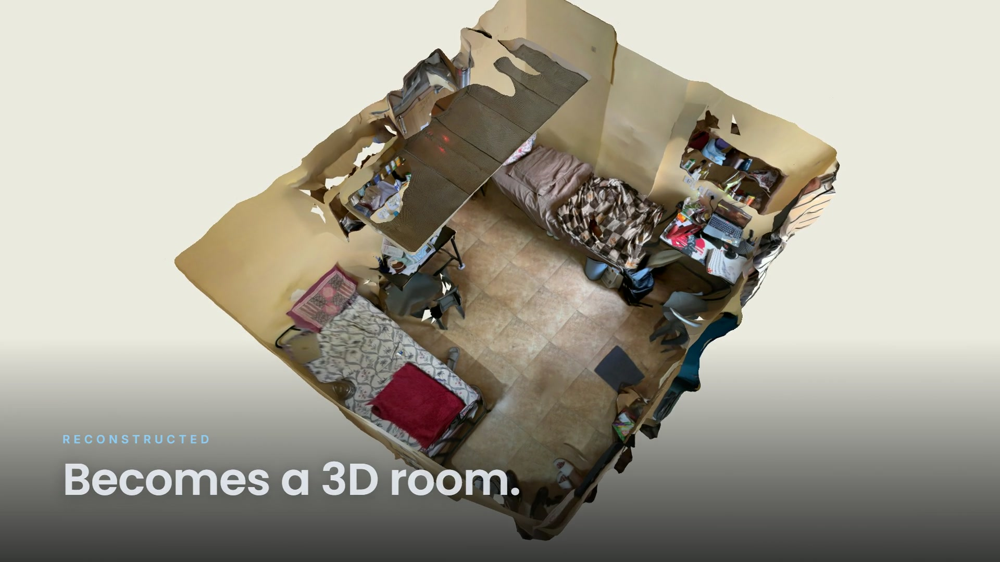
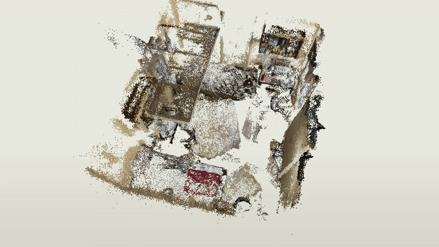
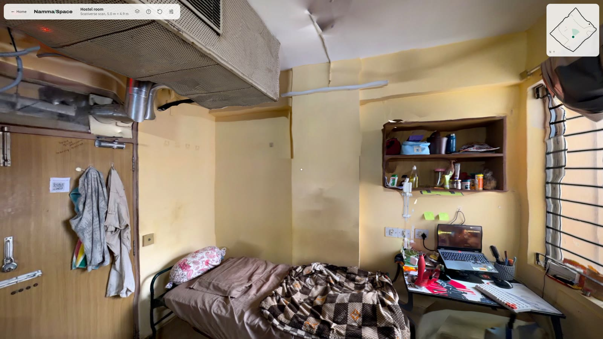
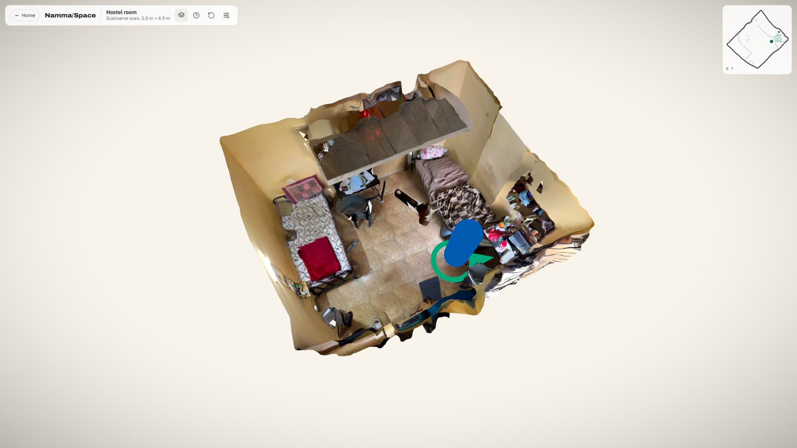
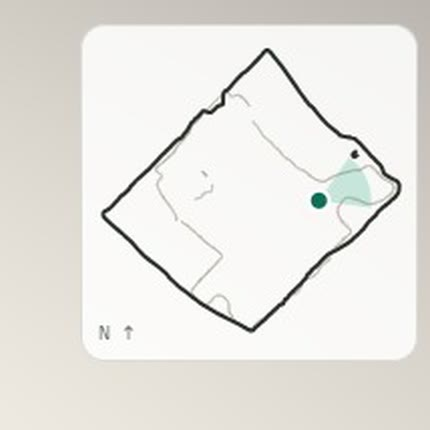
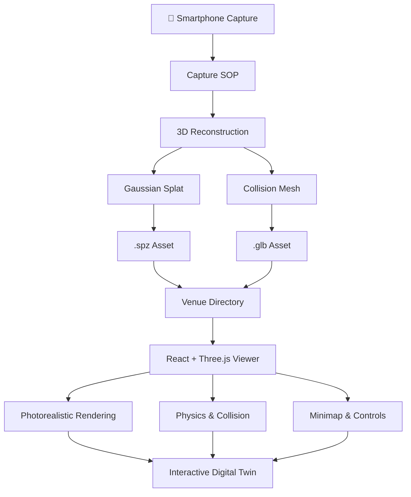
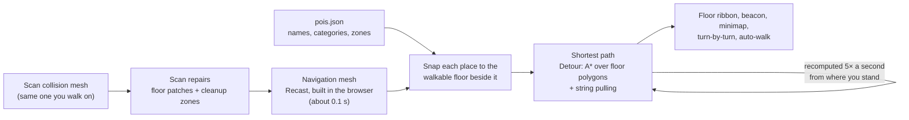
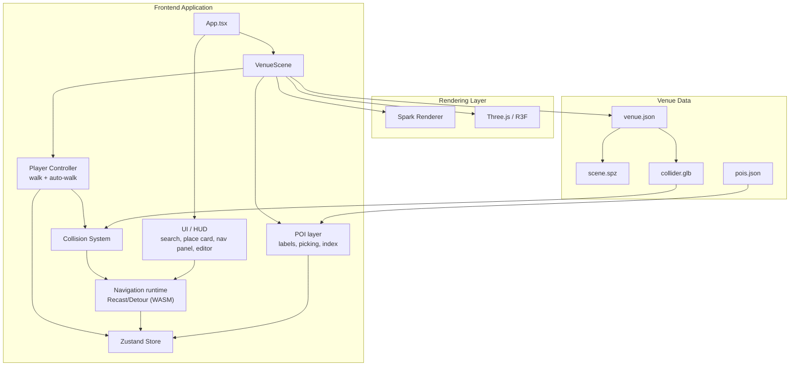

# ◈ DOORWAY

<p align="center">
  
</p>

<p align="center">
  <strong>Live:</strong> <a href="https://namma-space-three.vercel.app">namma-space-three.vercel.app</a>
  &nbsp;·&nbsp;
  <strong>Walk the scan directly:</strong> <a href="https://namma-space-three.vercel.app/experience/">/experience/</a>
</p>

<p align="center">
  <strong>Digital Spaces. Reimagined.</strong>
  <br />
  Turn ordinary phone captures into photorealistic, explorable 3D digital twins.
  <br />
  <em>Capture a space. Reconstruct its world. Step inside.</em>
</p>

<p align="center">
  <a href="#-overview"></a>
  
  
  
</p>

<p align="center">
  <a href="#-features">Features</a> •
  <a href="#-how-it-works">How It Works</a> •
  <a href="#-getting-started">Get Started</a> •
  <a href="#-architecture">Architecture</a> •
  <a href="#-roadmap">Roadmap</a> •
  <a href="#-team">Team</a>
</p>

---

<p align="center">
  
</p>

<p align="center">
  <sub>One phone scan of a hostel room: the raw point cloud becomes the textured room you can walk through.</sub>
</p>

---

## ◈ Overview

What if you could walk through a building before ever setting foot inside it?

**Doorway** is an attempt to bridge the physical and digital worlds by transforming ordinary smartphone captures of indoor environments into photorealistic, interactive 3D digital twins.

Instead of relying on expensive scanning hardware or specialized equipment, Doorway aims to make spatial digitization accessible through everyday phones.

The reconstructed environments can be explored directly in a browser, navigated using intuitive movement controls, and eventually used for on-site augmented reality guidance.

Built for the **Namma Space** challenge at **Techfest 2026–27, IIT Bombay**.

### The idea

| Physical World | Digital World |
|:---:|:---:|
| 📱 Smartphone captures | 🧩 3D reconstruction |
| 🏢 Real indoor environments | 🌐 Interactive digital twins |
| 🚶 Physical navigation | 🎮 Browser-based exploration |
| 📍 Physical destinations | 🧭 Search and AR guidance |

## ✦ Features

### 01 — Photorealistic Reconstruction

Turn a smartphone scan (Scaniverse) into a walkable 3D twin, with no manual modelling.

- Textured scan meshes shown with their captured lighting (the live hostel room and classroom).
- Gaussian splats rendered with [Spark](https://sparkjs.dev) when a good splat is available (`?venue=katpadi`).
- Coloured point clouds turned into venues automatically, collision included (`pipeline/points-to-venue.mjs`).
- `pipeline/clean-mesh.mjs` removes floating debris and shrinks scans for the web (4K texture for phones, 8K for desktops).
- Real-world environments instead of manually modelled scenes.

### 02 — First-Person Exploration

Step inside reconstructed environments.

- WASD-based first-person movement.
- Mouse-controlled camera.
- Capsule-based player collision.
- Wall and floor collision handling.
- Smooth movement along collision surfaces.
- Mobile joystick and touch-based camera controls.

### 03 — Spatial Awareness

Understand the environment while exploring it.

- Opening fly-through: the whole space from above, then down to eye level.
- Overview mode (**V**): orbit the whole space, with the visitor's position marked.
- Real-time minimap, sliced from the scan geometry.
- Configurable movement and viewing settings.

### 04 — Venue-Based Architecture

Every reconstructed space is treated as independent data.

- Individual venue directories.
- `venue.json` configuration.
- Reusable scene-loading architecture.
- Add new environments without modifying application logic.

### 05 — Places, Search and Navigation (Round 2)

Find anything in the space and get walked to it, Google Maps style.

- **Places (POIs)** float as labels in 3D: rooms, seating, desks, facilities, exits. Aim at a room or object and click
  (or click it from the overview) to reveal its name; rooms light up on the floor.
- **Search** with **Ctrl K**: fuzzy and typo-tolerant ("kitchn", "loo", "where is the TV?"), with the walking distance to
  every result.
- **Show the way**: the shortest walkable route, computed on a navigation mesh built from the scan itself, so it stays
  on the floor and goes around walls and furniture. Animated chevrons on the floor, a beacon at the goal, turn-by-turn
  instructions, distance and time left, recomputed as you walk.
- **Transitions**: picking a place flies the camera up to show the whole route, then back down, turned to face the
  way to go. **Jump there** arcs the camera over the walls and lands you facing the place.
- **Walk me there** (**G**): the walker follows the route by itself, like a game character.
- **Shareable directions**: the address bar carries `?poi=<id>`, so a link opens straight into navigation.
- **Tagging editor** (`?edit=1`): click to place a POI, draw its room outline, name it, export `pois.json`.
  Built for tagging a freshly scanned venue in minutes at the finale.

### 06 — What's Coming Next

- On-site augmented reality guidance (Round 3).

---

## ◈ See It In Action

<p align="center">
  
  <br />
  <sub>01 / First person inside the scanned hostel room</sub>
</p>

<p align="center">
  
  &nbsp;
  
  <br />
  <sub>02 / Overview mode (V) &nbsp;&nbsp; 03 / Minimap sliced from the scan</sub>
</p>

All screenshots are frames from the running viewer.

---

## ⚙ How It Works

Doorway uses two complementary representations of the same physical environment.

**One representation for visual fidelity. Another for physical interaction.**



### Two representations. One environment.

| Layer | Technology | Responsibility |
|---|---|---|
| Visual layer | Textured scan mesh (default), Gaussian splat or point cloud | Photorealistic rendering |
| Geometry layer | GLB Mesh | Collision, floor plan and navigation |
| Acceleration | BVH | Efficient spatial queries |
| Application | Three.js / R3F | Interactive 3D environment |
| State | Zustand | Application state management |
| Venue system | JSON | Environment configuration |

### Why a separate visual layer and collision mesh?

**Visual layer — For Looks**

The visitor sees the scan as captured. For the live hostel room and classroom this is the textured mesh shown with its baked-in lighting, which looked sharpest at eye level for our captures. Gaussian splats (rendered with Spark) and coloured point clouds plug into the same slot when a capture provides them.

**Collision Mesh — For Walking**

A decimated mesh extracted from the same scan provides the physical geometry needed for navigation.

Using `three-mesh-bvh`, the application performs accelerated spatial queries and pushes the player capsule out of intersecting geometry.

This allows the player to:
- Stay grounded on the floor.
- Avoid walking through walls.
- Slide along collision surfaces.

The same geometry also provides the basis for floor-plan slicing and future navigation systems.

---

## 🧭 Navigation: how routes are computed



- **One source of truth.** The navigation mesh is built from the same collision mesh the walker collides with, and
  the routing agent is the same size as the walker (22 cm half-width, 1.5 m headroom, 20 cm steps). A route the
  navmesh finds is one you can actually walk.
- **Stays on the floor.** Bed and desk tops are walkable surfaces too, but nobody can step up 45 cm, so routes never
  use them; places on furniture snap to the floor beside it.
- **Real scans are messy.** A shiny floor can scan as a hump, a desk can hide a strip of floor from the phone.
  `venue.json` can patch floor gaps (`walkableFloor`) and drop artifacts (`cleanup`); the visible scan is unchanged.
  See [`pipeline/README.md`](pipeline/README.md#make-it-routable).
- **Click-to-reveal** looks the clicked floor point up in a grid index of POI outlines (`src/poi/spatial.ts`): the object
  under the cursor first, otherwise the smallest room around it.
- **Tested.** `npm test` checks that routes go through doorways and never through walls on the demo flat, keep their
  clearance, and that every tagged place in the real hostel and classroom scans is reachable from the entrance.

## 🧠 Architecture



### Project Structure

```text
doorway/
│
├── src/
│   ├── App.tsx
│   │
│   ├── scene/
│   │   ├── VenueScene.tsx       loads the visual layer, collision mesh, navmesh and places
│   │   ├── Player.tsx           first-person capsule walker, auto-walk along a route
│   │   ├── CameraDirector.tsx   fly-through, overview, route preview and "jump there" flights
│   │   ├── collider.ts          BVH collider and minimap slicing
│   │   ├── cleanup.ts           drops scan artifacts marked in venue.json
│   │   └── demoLayout.ts        procedural development layout
│   ├── nav/
│   │   ├── navmesh.ts           Recast navmesh build, floor snapping, shortest routes
│   │   ├── guidance.ts          turn-by-turn instructions and time estimates
│   │   ├── runtime.ts           navigate / jump / auto-walk actions
│   │   ├── NavLayer.tsx         route ribbon, goal beacon, walkable-area overlay
│   │   └── *.test.ts            pathfinding tests (demo flat + real scans)
│   ├── poi/
│   │   ├── types.ts, loadPois.ts   pois.json format and validation
│   │   ├── spatial.ts           grid index for click-to-reveal
│   │   ├── search.ts            fuzzy search (Fuse.js)
│   │   ├── PoiLayer.tsx         3D labels, room highlight, picking
│   │   └── PoiEditor.tsx        tagging editor (?edit=1)
│   ├── align/                   alignment tool (align.html)
│   ├── ui/                      top bar, search, place card, nav panel, editor panel, minimap
│   └── venue/                   venue.json types and loading
│
├── public/venues/<venue-id>/    venue.json + cleaned scan files + pois.json
│   ├── hostel/                  default venue (live)
│   ├── classroom/
│   └── katpadi/                 splat example
│
├── pipeline/                    clean-mesh, points-to-venue, compress-splat, check-venue
├── test/                        real sample capture + rebuild steps, and a synthetic test room
├── landing/                     landing site; the viewer is served at /experience/
├── docs/                        SOP.md, task lists, README images
├── .github/workflows/ci.yml     type-check, tests, venue checks and build on every push
├── vercel.json                  deployment
├── package.json
└── README.md
```

---

## 🚀 Getting Started

### Prerequisites

Make sure you have the following installed:

| Requirement | Version |
|---|---|
| Node.js | 20 or newer |
| npm | Included with Node.js |
| Git | Latest stable version |
| Browser | Modern WebGL-compatible browser |

### Installation

**1. Clone the repository**

```bash
git clone https://github.com/yashrajkanawade357/Namma-Space-Game-AR-VR.git
```

**2. Navigate to the project**

```bash
cd Namma-Space-Game-AR-VR
```

**3. Install dependencies**

```bash
npm install
```

**4. Start the development server**

```bash
npm run dev
```

**5. Open the viewer**

```text
http://localhost:5173/experience/
```

The viewer lives under `/experience/` because the landing site serves it there. To run the whole site
(landing page + viewer, production build) instead:

```bash
cd landing && npm install && npm start
```

and open `http://localhost:4173/`.

### Available Environments

| URL (after `/experience/`) | Description |
|---|---|
| *(none)* | **Hostel room**: Scaniverse scan, the default venue, 5 places tagged |
| `?venue=classroom` | Classroom: a second Scaniverse scan, 9.6 m × 9.2 m, 7 places (entrance, smart board, seating blocks…) |
| `?venue=demo` | Procedural flat with a living room, kitchen and bedroom, 12 places: the easiest way to see routing around walls |
| `?venue=katpadi` | The same capture shown as a Gaussian splat |
| `?venue=sample` | Synthetic test room from `test/venues/sample` |
| `?venue=<id>` | Any folder in `public/venues/<id>/` |
| `&poi=<id>` | Opens straight into directions to that place, e.g. `?venue=demo&poi=bedroom` |
| `&edit=1` | Tagging editor for that venue's places |

**Checks:** `npm test` (pathfinding, search, POI validation), `npm run typecheck`, `npm run check:venue -- public/venues/<id>`.
GitHub Actions runs all of them, plus the build, on every push.

---

## 🎮 Controls

| Action | Desktop | Mobile |
|---|---|---|
| Move forward | `W` | Joystick |
| Move backward | `S` | Joystick |
| Move left | `A` | Joystick |
| Move right | `D` | Joystick |
| Look around | Mouse | Touch drag |
| Move faster | `Shift` | — |
| Return to start | `R` | — |
| Overview of the whole space | `V` | Layers button |
| Skip the opening fly-through | Any key or click | Tap |
| Show controls | `H` | On-screen UI |
| Release mouse | `Esc` | — |
| Search places | `Ctrl K` or `/` | Search button |
| Reveal a room or object's name | Aim the crosshair and click, or click it in the overview | Tap a label |
| Show the way to the selected place | `Enter` | Card button |
| Jump there | `J` (or `Shift Enter` in search) | Card button |
| Walk me there (auto-walk) | `G` | Panel button |
| Stop navigating / close the card | `Esc` | Panel button |

**Desktop tip:** Click inside the 3D viewer to activate mouse look.

---

## 🏗 Add Your Own Venue

Doorway is designed around a reusable venue system.

A new environment should be deployable by adding its assets and configuration rather than rewriting application code.

### Step 1 — Capture

Follow the smartphone capture procedure:

📖 [`docs/SOP.md`](docs/SOP.md)

### Step 2 — Reconstruct

Process your capture using the pipeline documentation:

📖 [`pipeline/README.md`](pipeline/README.md)

### Step 3 — Generate Assets

Clean the Scaniverse mesh export (welds, removes floating debris, resizes the texture):

```bash
node pipeline/clean-mesh.mjs captures/home/scan.glb public/venues/home/home.glb --triangles 200000 --texture 4096
```

Then write `public/venues/home/venue.json` and line the model up with the alignment tool at
`http://localhost:5173/experience/align.html?venue=home` (level, scale, copy the transform).
Only have a point cloud? `node pipeline/points-to-venue.mjs scan.ply public/venues/home --z-up` builds the whole
venue, collision included. A full worked example with a real capture is in [`test/README.md`](test/README.md).

### Step 4 — Tag places

Open `http://localhost:5173/experience/?venue=home&edit=1`, press **V** for the overview, then **+ Add place**
and click where the label should go. Name it, pick a category, add other names people might search for,
and **Draw zone** around rooms (click the corners, Enter to finish). **Download pois.json** into
`public/venues/home/`. The format is in [`pipeline/README.md`](pipeline/README.md#places-poisjson).

### Step 5 — Validate

```bash
npm run check:venue -- public/venues/home
```

Turn on *Settings → Show walkable area* to see where routes can go. If a scan gap or artifact cuts the floor in two,
fix it with `walkableFloor` / `cleanup` in `venue.json` ([how](pipeline/README.md#make-it-routable)).

### Step 6 — Explore

```text
http://localhost:5173/experience/?venue=home
```

---

## 🗺 Roadmap

The project is being developed in three stages.

### Round 01 — Digital Reconstruction

- [x] React + Three.js application foundation
- [x] Venue-based asset architecture (`venue.json` per space)
- [x] Gaussian splat, textured mesh and point-cloud visual layers
- [x] First-person movement (WASD + mouse, touch joystick)
- [x] BVH-based collision against the scan mesh
- [x] Minimap sliced from the scan, opening fly-through, overview mode (V)
- [x] Capture SOP ([`docs/SOP.md`](docs/SOP.md))
- [x] Capture-to-venue pipeline: `clean-mesh.mjs`, `points-to-venue.mjs`, alignment tool, `check:venue`
- [x] Real captured venues: hostel room (default) and classroom
- [x] Live deployment with landing page: [namma-space-three.vercel.app](https://namma-space-three.vercel.app)

### Round 02 — Intelligent Navigation

- [x] Points of interest per venue (`pois.json`): rooms with floor outlines, objects, exits
- [x] Interactive 3D labels and click-to-reveal on the scan (grid spatial index)
- [x] Fuzzy search with walking distances (Ctrl K), shareable `?poi=` links
- [x] Navigation mesh built in the browser from the scan's collision mesh (Recast)
- [x] Obstacle-aware shortest routes (Detour), recomputed as you walk, with turn-by-turn guidance
- [x] Route preview, jump-there and auto-walk camera transitions
- [x] Tagging editor (`?edit=1`) and scan repairs for routing (`walkableFloor`, `cleanup`)
- [x] Tests for pathfinding on the demo flat and real scans; CI on every push

### Round 03 — Augmented Reality

- [ ] On-site capture at IIT Bombay
- [ ] Physical-to-digital environment alignment
- [ ] AR navigation guidance
- [ ] Real-world destination guidance
- [ ] Final integrated demonstration

<sub>Roadmap items reflect development targets, not completed functionality. Individual checkboxes should be updated as implementation is verified.</sub>

---

## 🧰 Tech Stack

<p align="center">
  
</p>

| Category | Technologies |
|---|---|
| Frontend | React, TypeScript, Vite |
| 3D Rendering | Three.js, React Three Fiber |
| Splat Rendering | Spark |
| Collision Detection | three-mesh-bvh |
| Navigation | recast-navigation-js (Recast navmesh + Detour pathfinding, WebAssembly) |
| Search | Fuse.js |
| State Management | Zustand |
| Testing & CI | Vitest, GitHub Actions |
| Styling | Tailwind CSS |
| Spatial Assets | Textured GLB meshes, Gaussian splats (.spz / .ply), point clouds (.ply) |
| Capture | Scaniverse (used for both live venues); Polycam as an alternative |
| Reconstruction & Processing | Scaniverse exports, gltf-transform + meshoptimizer (`clean-mesh.mjs`), our alignment tool |

---

## 👥 Team

Built with curiosity, experimentation, and a shared ambition to make physical spaces digitally accessible.

| Contributor | Responsibility |
|---|---|
| **Yashraj Kanawade** | Project coordination, 3D scanning and reconstruction |
| **Ashmit** | Web application and software engineering |
| **Harshit** | Scanning workflows and 3D model development |

<p align="center">
  <strong>Built for the Namma Space challenge · Techfest 2026–27 · IIT Bombay</strong>
  <br />
  <sub>From a smartphone capture to a world you can walk through.</sub>
</p>

---

<p align="center">
  
  
</p>

<p align="center">
  <em>Every space has a story. We're building a way to step inside it.</em>
</p>

## 🌍 Landing Website

The repository also includes the Doorway landing site in [`landing/`](landing/). It contains the Earth-backed Three.js intro and transitions into the viewer above.

```bash
cd landing
npm install
npm start
```

Open `http://localhost:4173/`. The start command builds the viewer into `landing/experience/` before serving the combined site.
